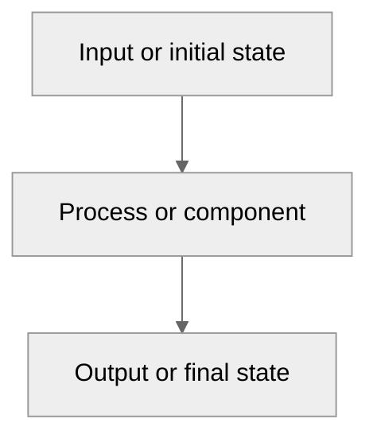

# REPLACE_DOCUMENT_TOPIC

## Scope and Conventions

### REPLACE_SCOPE_NAME

#### Definition / Principle

State what this note covers, the sign conventions used, and the assumptions
that apply throughout the document. Define abbreviations before using them.

## REPLACE_MAJOR_KNOWLEDGE_DOMAIN

### REPLACE_RETRIEVABLE_CONCEPT

#### Definition / Principle

Define one concept in self-contained language. Include the technical keywords
that a student is likely to use when searching for it.

#### Operating States / Mechanism

Describe the operating sequence, causal mechanism, or state transitions. Repeat
the topology and operating mode instead of referring to material “above.”

#### Formula Card: REPLACE_FORMULA_NAME

**Use when**

State the topology, operating mode, or physical situation where this formula
applies.

**Assumptions**

- State ideal or non-ideal conditions, polarity, mode, and approximations.

**Formula**

$$
EQUATION
$$

**Variables and units**

| Symbol | Meaning | Unit |
| --- | --- | --- |
| $x$ | REPLACE_DEFINED_QUANTITY | REPLACE_SI_UNIT_OR_DIMENSIONLESS |

**Sanity checks**

- State a limit, trend, polarity check, or dimensional check.

**Do not confuse with**

Name the nearest competing formula and explain the distinguishing condition.

#### Worked Example: REPLACE_EXAMPLE_NAME

**Given**

List all values and units needed to solve the example.

**Find**

State the required quantity and unit.

**Select the formula**

$$
EQUATION
$$

**Substitute**

$$
SUBSTITUTION_WITH_UNITS
$$

**Final answer**

$$
VALUE_AND_UNIT
$$

**Sanity check**

Explain why the magnitude, sign, and unit are reasonable.

#### Comparison Card: REPLACE_CONCEPT_A versus REPLACE_CONCEPT_B

| Property | REPLACE_CONCEPT_A | REPLACE_CONCEPT_B |
| --- | --- | --- |
| Energy path | REPLACE_DESCRIPTION | REPLACE_DESCRIPTION |
| Governing formula | REPLACE_FORMULA_OR_RULE | REPLACE_FORMULA_OR_RULE |
| Operating interval | REPLACE_CONDITION | REPLACE_CONDITION |
| Component stress | REPLACE_DESCRIPTION | REPLACE_DESCRIPTION |
| Common error | REPLACE_MISTAKE | REPLACE_MISTAKE |

#### Diagram Card: REPLACE_RELATIONSHIP_OR_OPERATING_SEQUENCE

**Purpose**

State the single relationship or sequence shown by the diagram.

**Diagram**

**Components**

- **A:** Define the input, state, device, or reference direction.
- **B:** Define the process, component, or energy-transfer path.
- **C:** Define the output or final state.

**State interpretation**

| State | Active path or relationship | Engineering meaning |
| --- | --- | --- |
| REPLACE_STATE | REPLACE_PATH | REPLACE_INTERPRETATION |

**Key observation**

State the one conclusion made clearer by the diagram.

**Do not confuse with**

Name the closest competing topology, state, or diagram convention.

#### Common Misconceptions

| Incorrect idea | Correct interpretation |
| --- | --- |
| REPLACE_LIKELY_MISTAKE | REPLACE_CORRECT_EXPLANATION |

#### Assessment Focus

- State the distinction, derivation, or interpretation that should be recalled.

#### Cross-Reference

- See `REPLACE_RELATED_NOTE_FILENAME` for REPLACE_RELATED_CONCEPT_AND_REASON.
